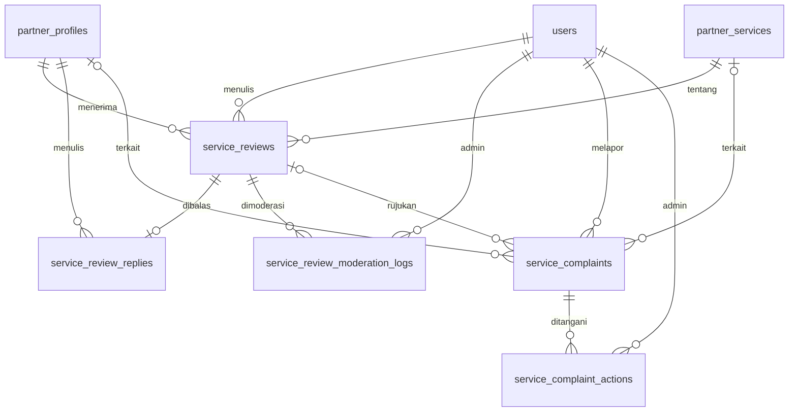

# JasaWarga — ERD Backend Tahap 5

**Sumber:** Tahap 1 (akun dan Mitra), Tahap 3 (kategori/layanan), Tahap 5 (feedback). **Tahap 4 belum digabung.**

## Skema dan batas integrasi

| Tabel baru | Tujuan | Identitas / batas penting |
|---|---|---|
| `service_reviews` | Rating umum, tiga rating detail, komentar, foto, status verifikasi/moderasi | ID Warga dari session, ID layanan & profil Mitra dari database; unik `(citizen_id, partner_service_id, booking_reference)` |
| `service_review_replies` | Satu balasan per ulasan, dapat diedit/hapus | `service_review_id` UNIQUE; kepemilikan Mitra dari session |
| `service_review_moderation_logs` | Audit sembunyikan/tampilkan dengan alasan wajib | `admin_id` hanya dari session |
| `service_complaints` | Laporan masalah Warga, status dan prioritas | `reporter_id` dari session; referensi pesanan opsional **belum dibuktikan** |
| `service_complaint_actions` | Riwayat tindakan Admin yang tidak ditimpa | `admin_id`, status/prioritas sebelum-sesudah, note |

**Aturan publik:** `verification_status=verified` DAN `moderation_status=visible` DAN Mitra `approved` + akun `active`. Tidak ada data demo `localStorage` yang diimpor. Pesanan Tahap 4 tidak direka: belum ada foreign key ke tabel booking.

## Alur ulasan

1. Warga login memilih layanan PostgreSQL dan memasukkan referensi pemesanan.
2. `ReviewBookingVerifier::isEligible()` melakukan verifikasi. Implementasi awal selalu `false`.
3. Review tersimpan `pending`, tidak terlihat publik maupun pada daftar balasan Mitra.
4. Setelah tim Tahap 4 mengimplementasikan verifier, Admin dapat menekan **Cek bukti Tahap 4**; hanya `true` (milik Warga, layanan sama, status selesai) membuatnya `verified`.
5. Admin dapat menyembunyikan dan mengembalikan visibilitas, serta menyimpan audit. Moderasi sendiri **tidak** membuat pending menjadi verified.
6. Mitra verified dan approved dapat membuat, memperbarui, dan menghapus satu balasan tanpa mengubah komentar Warga.

## Alur pengaduan

Warga memasukkan masalah; tautan `review_id` harus milik akun pengadu. Referensi kode pesanan bila ada adalah *klaim pelapor*, bukan bukti. Admin meninjau status lewat transisi `submitted → in_review → resolved/rejected`, dengan opsi buka kembali `resolved/rejected → in_review`, dan wajib memberi catatan setiap tindakan.

## Privasi & file

- Hanya Warga pelapor dan Admin yang dapat membaca pengaduan pada UI Tahap 5. Mitra tidak mempunyai akses ke detail pengaduan.
- Lampiran foto ulasan memakai `Storage::disk('public')` dengan format gambar dan batas 2 MB. Jangan mengunggah foto identitas sensitif. Jalankan `php artisan storage:link`.
- Semua output komentar ditampilkan melalui escaped Blade `{{ }}`, tidak melalui `{!! !!}`.
- Tidak disediakan seeder ulasan/pengaduan palsu. Untuk tes gunakan factories/test fixtures saja.

## Batas dan pekerjaan untuk Tahap 4

- Verifikasi kepemilikan, identitas layanan, status selesai dan kemungkinan refund perlu sumber pesanan nyata.
- Untuk pengaduan yang menyertakan `booking_reference`, lakukan pemeriksaan klaim sebelum keputusan yang bergantung pada order.
- Jika pesanan menggunakan ID numerik atau UUID, adapter memetakan `booking_reference` ke ID internal; tidak mengubah model Tahap 5 secara sepihak.
- Jika job background atau event tersedia, status `pending` dapat diverifikasi otomatis setelah pesanan menjadi `completed`. Pastikan idempotency dan jangan percaya input browser.
