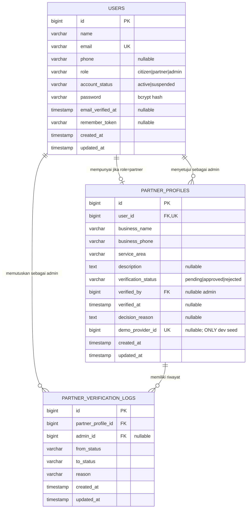

# JasaWarga — ERD Tahap 1: Auth + Verifikasi Mitra

## ERD implementasi (PostgreSQL)

**Keputusan desain**

1. `users.role` hanya salah satu dari `citizen`, `partner`, `admin` pada aplikasi. Pembuatan admin TIDAK ada endpoint publik.
2. `partner_profiles.user_id` unik: satu akun Mitra memiliki satu profil pendaftaran.
3. Status awal pendaftaran Mitra adalah `pending`; baru menjadi `approved` atau `rejected` melalui route Admin terlindungi `role:admin`.
4. `partner_verification_logs` mencatat aktor Admin, keputusan sebelumnya, keputusan baru, alasan, dan waktu. Audit sederhana ini tidak boleh diubah dari UI.
5. `demo_provider_id` dipakai **hanya** oleh akun seed lokal Mitra Budi Teknik untuk mengakses panel operasional dummy ID=1. Semua Mitra baru mendapat `null` sehingga tidak memperoleh data Budi Teknik.
6. `users.account_status = active|suspended` digunakan pada login dan middleware role. Pengaturan status Warga Admin lama masih localStorage dan **belum** menyentuh kolom ini.
7. Kolom enumerasi memakai `varchar` + whitelist pada aplikasi, agar mudah dimigrasi nanti; pertimbangkan `CHECK` constraints di migrasi produksi setelah analisis kebutuhan final.
8. `SESSION_DRIVER=file`, sehingga tidak diperlukan tabel `sessions` pada tahap ini. Hash password memakai cast `hashed` pada model.

## Bukan bagian migrasi tahap 1

Tabel `orders`, `services`, `categories`, `reviews`, `complaints`, `schedules`, dan `addresses` belum dibuat. Data pada halaman prototype tersebut tidak otomatis menjadi transaksi atau akun PostgreSQL. Tabel-tabel itu akan dimigrasikan bertahap setelah relasi pengguna dan Mitra operasional disiapkan. Tidak ada proses unggah dokumen verifikasi Mitra pada tahap ini.
