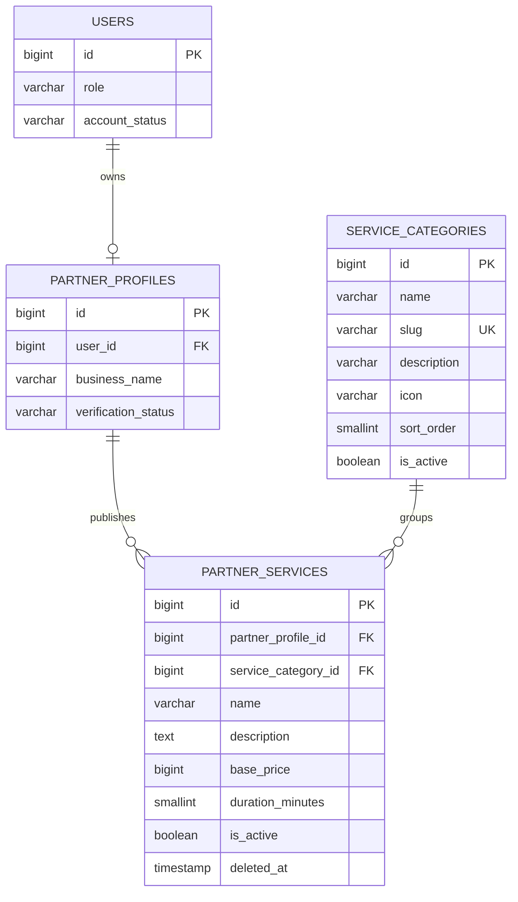

# ERD Backend Tahap 3 — Kategori dan Layanan Jasa

**Basis:** source JasaWarga Backend Tahap 1 (Laravel 12 + PostgreSQL). Tidak mengandung perubahan Tahap 2 yang sedang dibuat tim lain.

## Aturan domain

- `service_categories.slug` unik secara global. Relasi layanan menggunakan ID kategori, sehingga perubahan slug tidak mengubah foreign key.
- `partner_services.partner_profile_id` bersumber **selalu** dari sesi login, bukan field POST.
- Layanan tampil di katalog baru hanya bila: `partner_services.is_active`, `service_categories.is_active`, `partner_profiles.verification_status = approved`, `users.role = partner`, `users.account_status = active`, dan `partner_services.deleted_at IS NULL`.
- Tarif `base_price` berupa **bilangan bulat rupiah**, bukan float atau nominal pembayaran. Durasi dalam menit.
- Layanan dihapus secara **soft-delete**, supaya referensi historis bisa dibuat pada tahap transaksi berikutnya.
- Kategori tidak bisa dihapus jika pernah dipakai, termasuk oleh layanan yang diarsipkan. FK kategori memakai `RESTRICT ON DELETE`.
- Penonaktifan kategori menyembunyikan layanan publik. Pengaktifan kembali kategori dapat membuka kembali layanan yang sebelumnya tetap aktif.
- Tidak ada data layanan migrasi otomatis dari localStorage atau katalog Mitra dummy.

## Tabel dan penamaan

| Tabel | Sumber | Akses |
|---|---|---|
| `service_categories` | Admin PostgreSQL / seeder taksonomi opsional | Admin tulis; Mitra pilih aktif; publik baca aktif |
| `partner_services` | Mitra yang sudah disetujui | Pemilik tulis; publik lihat yang lolos filter |
| `users` | Backend Tahap 1 | Existing |
| `partner_profiles` | Backend Tahap 1 / Tahap 2 | Existing, **tidak diubah** |

## Di luar cakupan Tahap 3

- Tidak membuat tabel pesanan, jadwal, pembayaran, atau gambar portofolio.
- Tidak mengonversi katalog demo PHP menjadi akun/mitra database.
- Tidak menambahkan `service_id` ke formulir pemesanan `localStorage` lama; koneksi itu dilakukan pada Tahap 4 sesudah modul Tahap 2 digabungkan.
