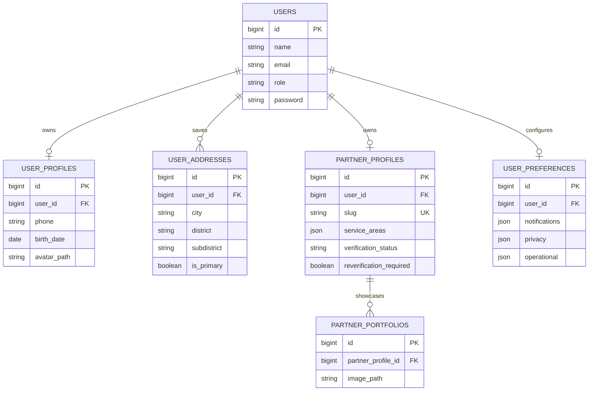

# JasaWarga — Tahap 2: Backend Profil & Akun Pengguna

**Isi paket:** modul Laravel untuk profil Warga, alamat Warga, pengaturan akun/preferensi, profil usaha Mitra, area layanan Makassar, portofolio pekerjaan, dan halaman profil publik Mitra. UI menggunakan Blade + Tailwind dan logo JasaWarga dari paket prototipe HTML yang tersedia.

> **Penting — prasyarat Tahap 1:** source project Laravel lengkap dan backend autentikasi Tahap 1 belum tersedia pada sesi pembuatan paket ini. Paket ini adalah **modul siap dipasang**, bukan project Laravel utuh. Paket mengasumsikan aplikasi Laravel 12/13, tabel `users` bawaan Laravel (`id`, `name`, `email`, `email_verified_at`, `password`, timestamps), session authentication aktif, serta route bernama `login`/`logout` atau penyesuaian pada layout. Migration paket menambahkan `users.role` bila belum ada. Registrasi/login dan role provisioning tetap harus disediakan Tahap 1.

## Cakupan tahap 2

### Warga
- Profil Warga: nomor WhatsApp, tanggal lahir, gender opsional, bio, dan foto profil.
- Edit nama/email akun melalui Pengaturan Akun; perubahan email mengosongkan `email_verified_at` agar wajib diverifikasi ulang.
- Kelola hingga 10 alamat, edit/hapus, alamat utama, dan pemindahan alamat utama secara transaksional.
- Ubah password dengan konfirmasi password saat ini, validasi minimal 8 karakter, hashing Laravel, dan regenerasi session.
- Preferensi notifikasi, privasi, dan zona waktu disimpan di PostgreSQL.

### Mitra
- Profil usaha, kategori, spesialisasi, deskripsi, pengalaman, kontak/WhatsApp, foto profil, dan cover.
- Area layanan dibatasi pada 15 kecamatan Kota Makassar.
- Portofolio maksimal 12 item dengan upload/preview foto yang tersimpan di public disk.
- Status verifikasi, catatan Admin, dan tanggal verifikasi **read-only** pada endpoint Mitra. Field ini tidak ada pada FormRequest maupun `$fillable`.
- Perubahan kecamatan/area ringkas setelah Mitra disetujui mengaktifkan `reverification_required`. Profil publik otomatis tidak ditemukan sampai Admin menyelesaikan pemeriksaan ulang dan menghapus flag tersebut.

### Profil publik Mitra
- URL `/profil-mitra/{slug}`.
- Hanya menampilkan Mitra dengan `verification_status=approved`, `reverification_required=false`, dan preferensi `profile_visible=true`.
- Nomor WhatsApp hanya tampil jika Mitra mengaktifkan `privacy.show_phone`.
- Alamat publik hanya area ringkas/kecamatan, bukan alamat rumah lengkap.

## Struktur data / ERD ringkas



## Cara memasang

1. Backup project Laravel yang sudah ada.
2. Ekstrak ZIP file perubahan ke root project Laravel dan izinkan merge/replace file baru. File yang ada di ZIP hanya path modul baru, bukan seluruh aplikasi.
3. Tambahkan baris ini di bagian bawah `routes/web.php`:

```php
require __DIR__.'/profile-stage2.php';
```

4. Pastikan `App\Models\User` adalah model autentikasi utama Laravel dan tabel `users` memiliki kolom `name`, `email`, `email_verified_at`, `password`, dan timestamps. Migration paket menambahkan `role` jika belum ada.
5. Pastikan Tahap 1 menetapkan role secara server-side: `warga`, `mitra`, atau `admin`. **Jangan mengambil role dari input registrasi bebas.** Contoh pada proses registrasi terverifikasi:

```php
$user = User::create([
    'name' => $validated['name'],
    'email' => $validated['email'],
    'password' => Hash::make($validated['password']),
]);
$user->forceFill(['role' => 'warga'])->save(); // nilai ditetapkan backend, bukan dari request
```

Untuk akun Mitra, role `mitra` hanya ditetapkan melalui alur pendaftaran Mitra yang sudah diverifikasi sesuai aturan Tahap 1. Jangan memberi role `admin` melalui registrasi publik.

6. Jalankan:

```bash
php artisan optimize:clear
php artisan migrate
php artisan storage:link
npm install
npm run dev
```

Pada terminal kedua:

```bash
php artisan serve
```

7. Pastikan login Tahap 1 aktif dan user sudah memiliki role yang benar. Kemudian uji route berikut.

## Route baru

| Role | URL | Route name |
|---|---|---|
| Warga | `/akun/profil` | `account.profile.show` |
| Warga | `/akun/profil/edit` | `account.profile.edit` |
| Warga | `/akun/alamat` | `account.addresses.index` |
| Warga | `/akun/alamat/tambah` | `account.addresses.create` |
| Warga/Mitra | `/akun/pengaturan` | `account.settings.show` |
| Warga/Mitra | `PUT /akun/pengaturan/password` | `account.settings.password` |
| Mitra | `/mitra/workspace/profil` | `partner.profile.edit` |
| Mitra | `/mitra/workspace/portofolio` | `partner.portfolio.index` |
| Publik | `/profil-mitra/{slug}` | `partners.public.show` |

## Catatan integrasi dengan frontend lama

- Paket menyediakan Blade layout mandiri `layouts.profile-stage2` agar tidak menimpa layout utama yang belum dapat diakses. Setelah source Laravel asli tersedia, pindahkan `@extends('layouts.profile-stage2')` ke layout desain utama dan sesuaikan navigasi.
- Halaman Detail Profil Mitra lama perlu diarahkan ke `route('partners.public.show', $profile->slug)` agar memakai data database. Route lama tidak ditimpa otomatis karena source route aslinya belum tersedia.
- Layanan/tarif, jadwal, pesanan, rating, dan dashboard tidak dimigrasikan pada tahap ini; tetap menjadi pekerjaan tahap berikutnya.
- Role Admin tidak diberi endpoint pengelolaan profil pada modul ini. Verifikasi status tetap menjadi kewenangan Admin pada modul administrasi berikutnya.
- Foto profil/cover/portofolio bersifat publik setelah tersimpan di disk `public`. Dokumen identitas/KTP tidak boleh diunggah ke field foto publik.
- Alamat Warga adalah data privat dan hanya dapat diakses pemilik akun melalui middleware `auth` + role Warga.

## Pengujian

Paket menyediakan 9 Feature Test pada `tests/Feature/ProfileStageTwoTest.php` untuk memeriksa:
- Update profil Warga.
- Pembuatan alamat dan pemilihan satu alamat utama.
- Pencegahan akses alamat milik Warga lain.
- Status verifikasi Mitra tidak bisa diubah melalui request Mitra.
- Perubahan area layanan memicu pemeriksaan ulang.
- Profil publik hanya tersedia untuk Mitra yang disetujui.
- Portofolio Mitra tidak dapat diakses Mitra lain.

Jalankan di dalam project Laravel setelah Tahap 1 terpasang:

```bash
php artisan test --filter=ProfileStageTwoTest
```

**Status validasi paket saat dibuat:** seluruh file PHP lolos `php -l`. Feature test belum dapat dijalankan karena source Laravel lengkap, vendor Composer, konfigurasi PostgreSQL, dan autentikasi Tahap 1 tidak tersedia dalam sesi ini. Jalankan migration/test pada project lokal sebelum dipakai.

## Referensi visual

Asset logo yang dipakai oleh layout modul diekstrak dari prototipe visual HTML yang tersedia dan berada di `public/images/jasawarga-logo.png`. Source HTML/CSS prototipe tidak disertakan agar tidak bercampur dengan source Laravel.
